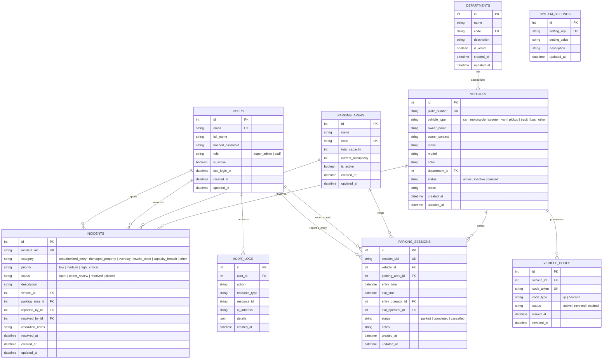

# ParkGuard — Database Schema & Data Models

### 1. Overview
The database layer is designed using **SQLAlchemy 2.0 ORM** with declarative models. It adheres to strict normalization standards, foreign key constraints, unique indexes, and audit timestamps. The schema is portable between **SQLite** (local development and single-server deployments) and **PostgreSQL** (distributed multi-container deployments).

---

### 2. Entity-Relationship Diagram (ERD)

---

### 3. Detailed Table Specifications

#### 3.1. `users`
Stores administrative and staff credentials, roles, and account statuses.
- `id` (INTEGER, Primary Key, Autoincrement)
- `email` (VARCHAR(255), Unique, Not Null, Indexed)
- `full_name` (VARCHAR(255), Not Null)
- `hashed_password` (VARCHAR(255), Not Null) — Argon2id or Bcrypt hash
- `role` (VARCHAR(50), Not Null, Default `'staff'`) — Values: `'super_admin'`, `'staff'`
- `is_active` (BOOLEAN, Not Null, Default `TRUE`)
- `last_login_at` (DATETIME, Nullable)
- `created_at` (DATETIME, Default UTC Now)
- `updated_at` (DATETIME, Default UTC Now)

#### 3.2. `departments`
Enterprise organizational divisions for vehicular classification.
- `id` (INTEGER, Primary Key, Autoincrement)
- `name` (VARCHAR(255), Not Null)
- `code` (VARCHAR(50), Unique, Not Null, Indexed)
- `description` (TEXT, Nullable)
- `is_active` (BOOLEAN, Not Null, Default `TRUE`)
- `created_at` (DATETIME, Default UTC Now)
- `updated_at` (DATETIME, Default UTC Now)

#### 3.3. `parking_areas`
Physical parking zones, garages, or lots with capacity enforcement.
- `id` (INTEGER, Primary Key, Autoincrement)
- `name` (VARCHAR(255), Not Null)
- `code` (VARCHAR(50), Unique, Not Null, Indexed)
- `total_capacity` (INTEGER, Not Null, Check `total_capacity >= 0`)
- `current_occupancy` (INTEGER, Not Null, Default `0`, Check `current_occupancy >= 0`)
- `is_active` (BOOLEAN, Not Null, Default `TRUE`)
- `created_at` (DATETIME, Default UTC Now)
- `updated_at` (DATETIME, Default UTC Now)

#### 3.4. `vehicles`
Master registry of authorized vehicles.
- `id` (INTEGER, Primary Key, Autoincrement)
- `plate_number` (VARCHAR(50), Unique, Not Null, Indexed)
- `vehicle_type` (VARCHAR(50), Not Null, Default `'car'`) — Allowed: `car`, `motorcycle`, `scooter`, `van`, `pickup`, `truck`, `bus`, `other`
- `owner_name` (VARCHAR(255), Not Null)
- `owner_contact` (VARCHAR(50), Nullable)
- `make` (VARCHAR(100), Nullable)
- `model` (VARCHAR(100), Nullable)
- `color` (VARCHAR(50), Nullable)
- `department_id` (INTEGER, Foreign Key referencing `departments.id`, Nullable)
- `status` (VARCHAR(50), Not Null, Default `'active'`) — Allowed: `'active'`, `'inactive'`, `'banned'`
- `notes` (TEXT, Nullable)
- `created_at` (DATETIME, Default UTC Now)
- `updated_at` (DATETIME, Default UTC Now)

#### 3.5. `vehicle_codes`
High-entropy cryptographic tokens for QR codes and barcodes.
- `id` (INTEGER, Primary Key, Autoincrement)
- `vehicle_id` (INTEGER, Foreign Key referencing `vehicles.id`, Not Null, Indexed)
- `code_token` (VARCHAR(100), Unique, Not Null, Indexed) — High-entropy UUID hex
- `code_type` (VARCHAR(50), Not Null, Default `'qr'`) — Values: `'qr'`, `'barcode'`
- `status` (VARCHAR(50), Not Null, Default `'active'`) — Values: `'active'`, `'revoked'`, `'expired'`
- `issued_at` (DATETIME, Default UTC Now)
- `revoked_at` (DATETIME, Nullable)

#### 3.6. `parking_sessions`
Transactional record of entry, exit, duration, and supervisory staff.
- `id` (INTEGER, Primary Key, Autoincrement)
- `session_uid` (VARCHAR(100), Unique, Not Null, Indexed)
- `vehicle_id` (INTEGER, Foreign Key referencing `vehicles.id`, Not Null, Indexed)
- `parking_area_id` (INTEGER, Foreign Key referencing `parking_areas.id`, Not Null, Indexed)
- `entry_time` (DATETIME, Not Null, Default UTC Now, Indexed)
- `exit_time` (DATETIME, Nullable)
- `entry_operator_id` (INTEGER, Foreign Key referencing `users.id`, Nullable)
- `exit_operator_id` (INTEGER, Foreign Key referencing `users.id`, Nullable)
- `status` (VARCHAR(50), Not Null, Default `'parked'`) — Values: `'parked'`, `'completed'`, `'cancelled'`
- `notes` (TEXT, Nullable)
- `created_at` (DATETIME, Default UTC Now)
- `updated_at` (DATETIME, Default UTC Now)

#### 3.7. `incidents`
Security reports, property damage, unauthorized entry attempts, or overstays.
- `id` (INTEGER, Primary Key, Autoincrement)
- `incident_uid` (VARCHAR(100), Unique, Not Null, Indexed)
- `category` (VARCHAR(100), Not Null)
- `priority` (VARCHAR(50), Not Null, Default `'medium'`) — Values: `'low'`, `'medium'`, `'high'`, `'critical'`
- `status` (VARCHAR(50), Not Null, Default `'open'`) — Values: `'open'`, `'under_review'`, `'resolved'`, `'closed'`
- `description` (TEXT, Not Null)
- `vehicle_id` (INTEGER, Foreign Key referencing `vehicles.id`, Nullable)
- `parking_area_id` (INTEGER, Foreign Key referencing `parking_areas.id`, Nullable)
- `reported_by_id` (INTEGER, Foreign Key referencing `users.id`, Nullable)
- `resolved_by_id` (INTEGER, Foreign Key referencing `users.id`, Nullable)
- `resolution_notes` (TEXT, Nullable)
- `resolved_at` (DATETIME, Nullable)
- `created_at` (DATETIME, Default UTC Now)
- `updated_at` (DATETIME, Default UTC Now)

#### 3.8. `audit_logs`
Tamper-resistant audit log capturing all system operations.
- `id` (INTEGER, Primary Key, Autoincrement)
- `user_id` (INTEGER, Foreign Key referencing `users.id`, Nullable, Indexed)
- `action` (VARCHAR(100), Not Null, Indexed)
- `resource_type` (VARCHAR(100), Not Null, Indexed)
- `resource_id` (VARCHAR(100), Nullable)
- `ip_address` (VARCHAR(50), Nullable)
- `details` (JSON / TEXT, Nullable)
- `created_at` (DATETIME, Default UTC Now, Indexed)

#### 3.9. `system_settings`
Dynamic key-value operational preferences configured by Super Admin.
- `id` (INTEGER, Primary Key, Autoincrement)
- `setting_key` (VARCHAR(100), Unique, Not Null, Indexed)
- `setting_value` (TEXT, Not Null)
- `description` (VARCHAR(255), Nullable)
- `updated_at` (DATETIME, Default UTC Now)

---

### 4. Integrity Rules & Business Invariants
1. **Single Active Parking Session**: A vehicle cannot have more than one record in `parking_sessions` where `status = 'parked'`. An attempt to record an entry while parked raises HTTP `400 Bad Request`.
2. **Atomic Capacity Synchronization**: When an entry is recorded, `parking_areas.current_occupancy` increments atomically. When exit is recorded, `current_occupancy` decrements safely (guarded against underflow below zero).
3. **No Hard Deletes**: Vehicles, departments, and parking zones with historical parking sessions or incident associations cannot be deleted via API. Deactivation flags (`status = 'inactive'`, `is_active = FALSE`) are applied to preserve auditability.
4. **Token Invalidation**: When a vehicle's pass is revoked or regenerated, all previous `vehicle_codes` are marked `revoked` and immediately rejected by the scanner endpoint.
